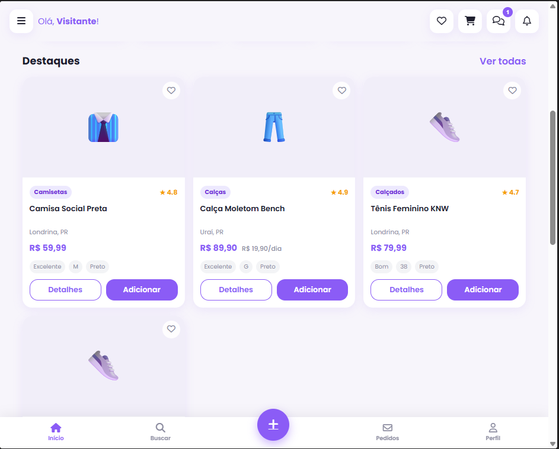
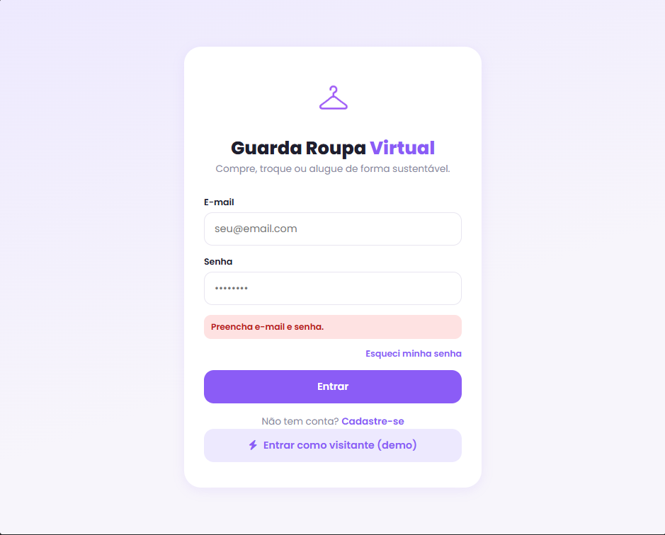
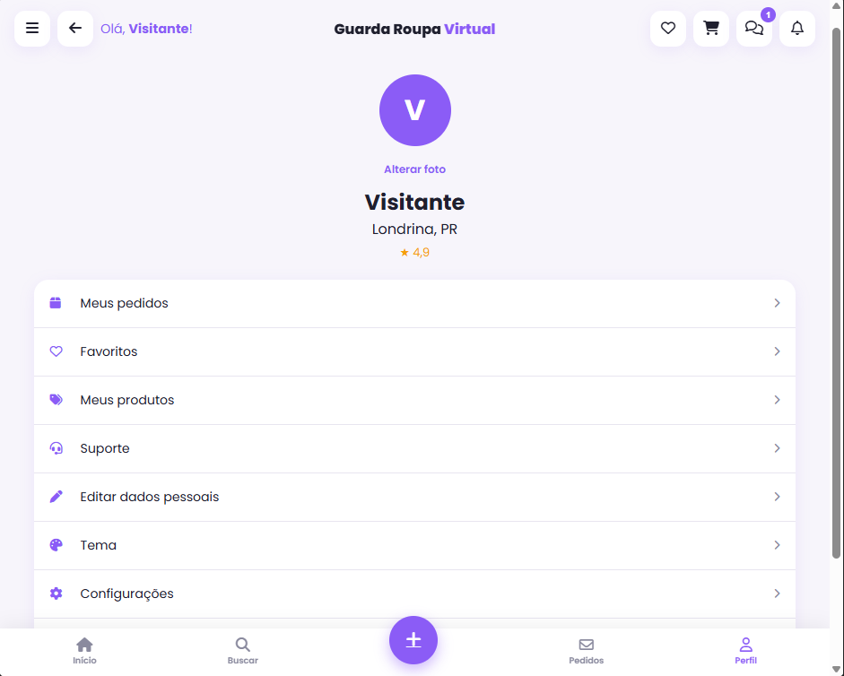

# Guarda-Roupa Virtual

Marketplace acadêmico de compra, venda, troca e aluguel de roupas, com foco em moda circular.

## Como executar

### Opção 1 — abrir pelo terminal

1. Instale o Node.js versão 18+.
2. Abra o terminal na pasta do projeto.
3. Execute:
   `npm install`
   `npm start`
4. Abra `http://localhost:3000` no navegador.

### Opção 2 — pelo VS Code

- Terminal > Run Task > `Start app`

> O projeto precisa do servidor local em `server.js` para funcionar corretamente. Se abrir só o HTML, ele pode ficar incompleto ou "desconfigurado".

Também é possível navegar como visitante. Para publicar anúncios, crie uma conta com senha de pelo menos 8 caracteres.

Contas, sessões, anúncios, estoque e pedidos são mantidos em `data/marketplace.sqlite`, criado automaticamente e ignorado pelo Git. Os produtos de `products.json` são importados como catálogo inicial. Senhas usam `scrypt`; sessões usam cookie `HttpOnly`. Contas e pedidos antigos que existiam somente no `localStorage` não são importados.

## Funcionalidades

- Catálogo com busca, categorias, filtros e ordenação.
- Favoritos e carrinho locais; preços, cupons e estoque são conferidos pelo servidor no checkout.
- Cadastro e login com sessão no servidor; perfil básico persistente.
- Publicação, edição e exclusão de anúncios com imagem.
- Pedidos de demonstração persistentes, preço/cupom validados pelo servidor, reserva transacional de estoque e cancelamento que libera as peças.
- Chat persistente entre contas em anúncios publicados; avaliações e suporte ainda são locais ou simulados.
- Idioma em português, inglês e espanhol e moeda em BRL, USD ou EUR.

## Arquivos de configuração e dados

- `package.json`: dependências e comandos para iniciar o app e rodar os testes.
- `package-lock.json`: versões exatas das dependências instaladas pelo npm.
- `products.json`: catálogo inicial importado para o banco local na primeira inicialização.
- `site.webmanifest`: nome, cores, ícone e modo de abertura quando o site é instalado como app.
- `.vscode/tasks.json`: tarefa do VS Code que inicia o servidor com `npm start`.

Esses arquivos JSON não recebem comentários dentro do próprio arquivo porque o formato JSON não permite comentários válidos.

## Demonstração

Capturas de tela do site:

| Tela inicial | Catálogo de produtos |
| --- | --- |
|  |  |

| Login | Publicação de item |
| --- | --- |
|  |  |

| Perfil | Conversa com vendedor |
| --- | --- |
|  |  |

## Limitações atuais

Este projeto ainda é um protótipo. O checkout cria apenas pedidos de demonstração: não cobra, não envia e não coleta cartão, CVV, CPF ou endereço. O estoque é reservado na base SQLite local e pode ser liberado cancelando o pedido. Favoritos, carrinho, avaliações e suporte continuam no navegador; o chat persiste mensagens por anúncio e participante, mas não tem notificações em tempo real. Aluguel e troca são exibidos, mas ainda não aceitam reservas ou propostas. A persistência SQLite atual é adequada ao protótipo de um único processo; produção exige infraestrutura de banco adequada, armazenamento externo de imagens, HTTPS, políticas de privacidade e provedor de pagamento com confirmação por webhook.
